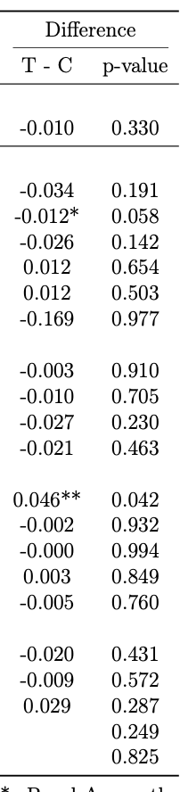
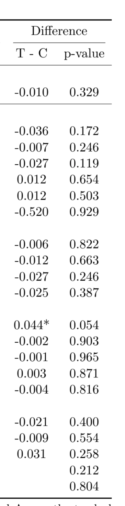

# Paper Identification

|  |   |
| ---  |  -------|
| ID  |   |
| Author  |   |
| Title  |   |
| Iteration |   |

Some useful information up front:

- [JPE Data and Code Availability Policy](https://www.journals.uchicago.edu/journals/jpe/datapolicy)
- [Step by step guidance from Data Editor for Authors](https://jpedataeditor.github.io/) 
- [Template README](https://social-science-data-editors.github.io/template_README/)

# Summary

In assessing compliance with our [Data and Code Availability Policy](https://www.journals.uchicago.edu/journals/jpe/datapolicy), our reproducibility team has identified the following issues, which we ask you to address:

1. You need to cite your raw data in readme (done) as well as paper.
2. Table A15 does not correspond.
3. Few things to add to readme as per below.

# General

- [x] Data Availability and Provenance Statements
  - [x] Statement about Rights - Part 1: Right to use the data (e.g. *did the authors lawfully obtain the data*)
  - [ ] Statement about Rights - Part 2: Right to publish the data (e.g. *are human subjects involved and did permission been granted to publish their data?*)
  - [x] License for Data (optional, but recommended)
  - [x] Details on each Data Source
- [x] Dataset list
- [x] Computational requirements
  - [x] Software Requirements
  - [x] Controlled Randomness (as necessary)
  - [x] Memory, Runtime, and Storage Requirements
- [x] Description of programs/code
  - [x] License for Code (Optional, but recommended) 
- [x] List of tables and programs
- [x] References (Optional, but recommended) 


# High-level Description of Research Project

*This research project...*

- [ ] uses observational data.
- [x] uses *confidential* observational data.
- [ ] uses data generated via experiment or trial by the authors (in field or lab).
  - [ ] For lab experiments: The code to implement the experimental protocol (z-Tree, o-Tree etc) is included in the package.
  - [ ] A PDF copy of IRB approval is contained in the package.
  - [ ] A PDF document outlining the design of the experiment, including information on the selection and eligibility of participants is included.
  - [ ] A PDF copy of the instructions given to participants in both original language and an English translation is included.
- [ ] uses data generated via survey by the authors (in field or online)
  - [ ] The programs used to administer the survey (e.g. qualtrics survey file) are included.
  - [ ] A PDF copy of IRB approval is contained in the package.
  - [ ] A PDF of the original questionaire(s) and information on the selection and eligibility of participants is included.
- [ ] is a simulation study: the data are generated by an algorithm.
- [ ] is a numerical illustration: no data are used but code is used to produce illustrative output (tables, figures)
- [x] uses data generated via a survey experiment, which was not done by the authors. 
  - The authors have provided a detailed section in the readme that highlights:
    - the technology that was used
    - the consent and tracking that was requested and received from the participants
    - the creation of the treatment and control group
    - any comprehension checks
    - all other details as required
    - The study was determined to be exempt from review by the IRB and supporting documentation has been provided.

# Data description

For any data that cannot be provided as part of the replication package, please provide the following information as part of the README.

> {REQUIRED}  Please specify how long the data will be preserved in the restricted-access location.

> {REQUIRED} Please provide affirmation of support for replication checks.
  - As per the [JPE policy](https://jpedataeditor.github.io/policy.html), "In cases where data cannot be published in an openly accessible trusted data repository like the JPE dataverse, authors who have requested an exemption to publish them at the time of first submission must commit to preserving the data and code for a period of no less than five years following the publication of the paper. They should also provide reasonable assistance to requests for clarification and replication."


## Data Sources

| file/name | public | private | shared with us | DOI/URL | Access described | cited readme | cited paper |
| ---- | --- | --- | --- | --- | --- | ---- | ---- |
| SZ Picture-Quiz Field Experiment (SZAP-1385) | no | yes | yes | no | yes | yes | no |
| SZ Follow-Up Survey (Feb 2026) | no | yes | yes | no | yes | yes | no |
| SZ Article Category Supply, 2024–2025 | no | yes | yes | no | yes | yes | no |

### Data: SZ Picture-Quiz Field Experiment (project SZAP-1385)

- [ ] Dataset is provided in public deposit
- [x] Dataset is PRIVATELY provided (not for publication)
- [ ] DOI or URL is provided, and works:
  - No DOI or URL is given.
- [x] Access conditions are described:
  - Described in the Data Availability Statement, according to the citation.
- [ ] Data are not cited, but a working paper, article, or other document is cited (not a data citation)
- [x] Data are cited
  - [ ] in the manuscript
  - [x] in the README:

> Süddeutsche Zeitung Digitale Medien GmbH. 2025. "SZ Picture-Quiz Field Experiment (project SZAP-1385): Survey Responses, Digital Usage and Subscription Records, February–March 2025." Proprietary data. Extracts of March 2025 – April 2026. Not publicly available; access conditions described in the Data Availability Statement above.

### Data: SZ Follow-Up Survey (February 2026)

- [ ] Dataset is provided in public deposit
- [x] Dataset is PRIVATELY provided (not for publication)
- [ ] DOI or URL is provided, and works:
  - No DOI or URL is given.
- [x] Access conditions are described:
  - Described in the Data Availability Statement, according to the citation.
- [ ] Data are not cited, but a working paper, article, or other document is cited (not a data citation)
- [x] Data are cited
  - [ ] in the manuscript
  - [x] in the README:

> Süddeutsche Zeitung Digitale Medien GmbH. 2026. "SZ Follow-Up Survey (February 2026)." Proprietary data, extract of February 2026. Not publicly available.

### Data: SZ Article Category Supply, 2024–2025

- [ ] Dataset is provided in public deposit
- [x] Dataset is PRIVATELY provided (not for publication)
- [ ] DOI or URL is provided, and works:
  - No DOI or URL is given.
- [x] Access conditions are described:
  - Described in the Data Availability Statement, according to the citation.
- [ ] Data are not cited, but a working paper, article, or other document is cited (not a data citation)
- [x] Data are cited
  - [ ] in the manuscript
  - [x] in the README:

> Süddeutsche Zeitung Digitale Medien GmbH. 2026. "SZ Article Category Supply, 2024–2025." Proprietary data, extract of January 2026. Not publicly available.


# Requirements 

- [x] README is in TXT, MD, or PDF format
- [x] README is accessible at the root of the package (not inside a folder)
- [ ] Title conforms to guidance (starts with "Data and Code for: Title of Paper" or "Code for: Title of Paper", is properly capitalized)
- [ ] Authors (with affiliations) are listed in the same order as on the paper

> {REQUIRED} Please review the title of the deposit as per our guidelines.

> {REQUIRED} Please review authors and affiliations on the deposit. In general, they are the same, and in the same order, as for the manuscript; however, authors can deviate from that order.


## Stated Requirements

- [ ] No requirements specified
- [x] Software Requirements specified as follows:
  - Stata 15.1 or newer, any edition.
    - Packages include `reghdfe`, `ftools`, `require`, `ppmlhdfe`, `estout`, `coefplot`, `heatplot`, `palettes`, `colrspace`, `grstyle`, `scheme-modern`
  - Python >= 3.8
    - Packages includes `numpy`, `pandas`, `openpyxl`.
- [x] Computational Requirements specified as follows:
  - 2 GB Disk Space
  - 8 GB RAM
- [x] Time Requirements specified as follows:
  - 3 minutes without package installation.
  - 4 minutes with package installation.

- [x] Requirements are complete.


# Analyzing Data and Code Files














## Code description








- [x] The replication package contains a "main" or "master" file(s) which calls all other auxiliary programs.
- There are 17 Stata `.do` files and one Python `.py` file. 

> NOTE: In-text numbers that reference numbers in tables do not need to be listed. Only in-text numbers that correspond to no table or figure need to be listed.

## Computing Environment of the Replicator

- Nuvolos Virtual Machine, "Ubuntu 22.04.4 LTS", AMD EPYC 9354P 32-Core Processor, 16 GB Memory.
- STATA 15.1 MP

- R `sessionInfo()` result below:
```R
R version 4.5.2 (2025-10-31)
Platform: x86_64-pc-linux-gnu
Running under: Ubuntu 22.04.4 LTS

Matrix products: default
BLAS:   /usr/lib/x86_64-linux-gnu/openblas-pthread/libblas.so.3 
LAPACK: /usr/lib/x86_64-linux-gnu/openblas-pthread/libopenblasp-r0.3.20.so;  LAPACK version 3.10.0

locale:
 [1] LC_CTYPE=en_US.UTF-8       LC_NUMERIC=C               LC_TIME=en_US.UTF-8        LC_COLLATE=en_US.UTF-8    
 [5] LC_MONETARY=en_US.UTF-8    LC_MESSAGES=en_US.UTF-8    LC_PAPER=en_US.UTF-8       LC_NAME=C                 
 [9] LC_ADDRESS=C               LC_TELEPHONE=C             LC_MEASUREMENT=en_US.UTF-8 LC_IDENTIFICATION=C       

time zone: Etc/UTC
tzcode source: system (glibc)

attached base packages:
[1] stats     graphics  grDevices utils     datasets  methods   base     

loaded via a namespace (and not attached):
[1] compiler_4.5.2    cli_3.6.5         rsconnect_1.7.0   tools_4.5.2       rstudioapi_0.17.1 lifecycle_1.0.4  
[7] rlang_1.1.6   
```

# Replication

- Downloaded code and data from dropbox.
- Changed working directory to `/files/JPE-Sen-20251182/replication-package/JPE_replication_package_DataEditor_Nov2026`
- Ran `MASTER.do` as per instructions.
- Code ran to completion. 

# Findings {#sec-findings}


## Data Preparation Code

| Data Preparation Program         | Dataset created                              | Reproduced? |
|----------------------------------|----------------------------------------------|-------------|
| 00_build_datasets.do             | temp/survey.dta                              | Yes         |
| 00_build_datasets.do             | temp/panel.dta                               | Yes         |
| 04a_build_purecontrol_attempt.do | temp/purecontrol_attempt.dta                 | Yes         |
| 06_build_topic_panel.do          | temp/SZ_fine_topics.dta                      | Yes         |
| 07_build_article_type_panel.do   | temp/article_type.dta                        | Yes         |
| 09_followup_survey_figures.do    | temp/survey_original_and_followup_joined.dta | Yes         |
| 12_followup_balance.do           | temp/followup_balance_stats.dta              | Yes         |
| 13_appendixE_relative_trust.do   | temp/appendixE_stats.dta                     | Yes         |

- All programs ran as expected.

## Tables and Figures

| Figure/Table # | Program                        | Line Number | Reproduced?   |
|----------------|--------------------------------|-------------|---------------|
| Figure 1       | 10_additional_exhibits.do      | 55          | Yes           |
| Figure 2(a)    | 02_survey_outcomes.do          | 139         | Yes           |
| Figure 2(b)    | 08_revision_tables_figures.do  | 557         | Yes           |
| Figure 3       | 08_revision_tables_figures.do  | 931         | Yes           |
| Figure 4       | 04_subscription_outcomes.do    | 58          | Yes           |
| Table 1        | 03_panel_outcomes.do           | 102         | Yes           |
| Table 2        | 08_revision_tables_figures.do  | 45          | Yes           |
| Table 3        | 08_revision_tables_figures.do  | 204         | Yes           |
| Table 4        | 04_subscription_outcomes.do    | 67          | Yes           |
| Table 5        | 08_revision_tables_figures.do  | 105         | Yes           |
| Figure A.1(a)  | 02_survey_outcomes.do          | 254         | Yes           |
| Figure A.1(b)  | 02_survey_outcomes.do          | 298         | Yes           |
| Figure A.2     | 02_survey_outcomes.do          | 155         | Yes           |
| Figure A.3     | 08_revision_tables_figures.do  | 755         | Yes           |
| Figure A.4     | 05_subscription_expanded.do    | 110         | Yes           |
| Table A.1      | 09_followup_survey_figures.do  | 312         | Yes           |
| Table A.2      | 01_balance_tables.do           | 146         | Yes           |
| Table A.3      | 02_survey_outcomes.do          | 343         | Yes           |
| Table A.4      | 02_survey_outcomes.do          | 570         | Yes           |
| Table A.5      | 02_survey_outcomes.do          | 448         | Yes           |
| Table A.6      | 08_revision_tables_figures.do  | 633         | Yes           |
| Table A.7      | 08_revision_tables_figures.do  | 247         | Yes           |
| Table A.8      | 08_revision_tables_figures.do  | 353         | Yes           |
| Table A.9      | 03_panel_outcomes.do           | 467         | Yes           |
| Table A.10     | 03_panel_outcomes.do           | 578         | Yes           |
| Table A.11     | 03_panel_outcomes.do           | 710         | Yes (partial) |
| Table A.12     | 03_panel_outcomes.do           | 244         | Yes           |
| Table A.13     | 05_subscription_expanded.do    | 165         | Yes           |
| Table A.14     | 08_revision_tables_figures.do  | 454         | Yes           |
| Table A.15     | 12_followup_balance.do         | 131         | Yes (partial) |
| Table A.16     | 09_followup_survey_figures.do  | 209         | Yes           |
| Table A.17     | 10_additional_exhibits.do      | 108         | Yes           |
| Table E.1      | 13_appendixE_relative_trust.do | 87          | Yes           |
| Table E.2      | 13_appendixE_relative_trust.do | 265         | Yes           |
| Table E.3      | 13_appendixE_relative_trust.do | 301         | Yes           |

- Table A11: minor 0.001 differences in Sample Mean SEs. Computational difference.
- Table A15: Difference column is different for T-C and p-value (see below)

::: {#fig-three layout-ncol=2 layout-valign="top"}

{height=4in}

{height=4in}

Table A.15: paper vs. replicated
:::

## In-Text Numbers

- [ ] In-text numbers not verified.

- [ ] There are no in-text numbers, or all in-text numbers stem from tables and figures.

- [ ] There are in-text numbers, but they are not identified in the code

- [x] In-text numbers verified, minor issues in one of them.

| In-text numbers                                                                               | Program                       | Line Number | Reproduced? |
|-----------------------------------------------------------------------------------------------|-------------------------------|-------------|-------------|
| Fn 5: control group, share reporting maximum trust in SZ (92%)                                | 11_intext_numbers.do          | 53          | Yes         |
| Fn 5: control group, share reporting trust in SZ below 2 (0.6%)                               | 11_intext_numbers.do          | 56          | Yes         |
| Fn 7: treatment, mean number of correct answers (0.9)                                         | 11_intext_numbers.do          | 61          | Yes         |
| Fn 7: treatment, share answering all three correctly (about 2.5%)                             | 11_intext_numbers.do          | 66          | Yes         |
| Fn 7: treatment, share answering all three wrong (36%)                                        | 11_intext_numbers.do          | 69          | Yes         |
| Sec 4.1: treatment, share of correct responses (29%)                                          | 11_intext_numbers.do          | 79          | Yes         |
| Fn 32: treatment, share correct by picture pair (20% / 36% / 30%)                             | 11_intext_numbers.do          | 83          | Yes         |
| Sec 4.1: treatment, mean perceived difficulty (4.7)                                           | 11_intext_numbers.do          | 89          | Yes         |
| Sec 4.1: control, mean perceived difficulty (1.52)                                            | 11_intext_numbers.do          | 92          | No (minor)  |
| Sec 4.1: control, share answering all three correctly (72%)                                   | 11_intext_numbers.do          | 102         | Yes         |
| Sec 4.1: control, share of correct responses (89%)                                            | 11_intext_numbers.do          | 106         | Yes         |
| Sec 4.1: median survey completion time, all / treatment / control (4:06 / 4:20 / 3:54)        | 11_intext_numbers.do          | 121         | Yes         |
| Fn 19: subscribers taking the quiz on March 1 / 2 / 3, 2025 (71% / 17% / 6%)                  | 11_intext_numbers.do          | 135         | Yes         |
| Fn 34: prop. test of answering gender and WTP, T vs C (p = 0.66)                              | 11_intext_numbers.do          | 149         | Yes         |
| Fn 38: misinfo concern = 6 / = 5, treatment (77% / 18%) and control (62% / 30%)               | 11_intext_numbers.do          | 178         | Yes         |
| Sec 5.1: control, mean trust in LI (1.32)                                                     | 11_intext_numbers.do          | 186         | Yes         |
| Sec 5.2.2: 25th / 75th percentile of pre-period visits, tracked sample (20 / 145)             | 11_intext_numbers.do          | 210         | Yes         |
| Sec 5.2.2: high / low politics affinity, tracked sample (57% / 43%)                           | 11_intext_numbers.do          | 214         | Yes         |
| Sec 5.3.1 / Abstract: reduction in attrition rate at 5 months (about 30%)                     | 11_intext_numbers.do          | 225         | Yes         |
| Sec 5.3.1: annual subscription revenue gain (456,000 EUR)                                     | 11_intext_numbers.do          | 237         | Yes         |
| Fn 50: average effect of SZ's three past email experiments on 3-month retention (0.55 p.p.)   | Not in package                |             | N/A         |
| Sec 5.2.1: mean daily visits days 1-5 post, treated / control (4.83 / 4.69)                   | 11_intext_numbers.do          | 253         | Yes         |
| Sec 5.2.1: t-test p-value, days 1-5 post (0.032)                                              | 11_intext_numbers.do          | 254         | Yes         |
| Sec 5.2.1: difference in means relative to control (2.9%)                                     | 11_intext_numbers.do          | 255         | Yes         |
| Sec 1 / 5.2.1: visits effect relative to sample mean, windows +3 and +5 (about 2.5%)          | 11_intext_numbers.do          | 264         | Yes         |
| Sec 5.2.2: high / low politics affinity, DiD sample (57% / 43%)                               | 11_intext_numbers.do          | 274         | Yes         |
| Sec 5.2.2: low-politics visits effect relative to sample mean, Table 2 col (1) (about 3.4%)   | Not computed in package       |             | Yes         |
| Sec 5.2.3: p-value of hard-news effect, Table 3 col (1) (p = 0.11)                            | 08_revision_tables_figures.do | 169         | Yes         |
| Sec 5.3.1: alternative control, mean daily visits, all days (3.1)                             | 11_intext_numbers.do          | 288         | Yes         |
| Sec 5.3.1: alternative control, mean daily visits, pre-period (3.1)                           | 11_intext_numbers.do          | 291         | Yes         |
| Sec 5.3.1: daily visits by subscribers (at least 900,000)                                     | 11_intext_numbers.do          | 296         | Yes         |
| Sec 5.3.1: additional daily visits (about 23,000)                                             | 11_intext_numbers.do          | 298         | Yes         |
| Sec 5.3.1: retained subscribers (about 3,500)                                                 | 11_intext_numbers.do          | 301         | Yes         |
| Sec 5.3.1 / Sec 1: annual visits from retained subscribers (over 3.9 million; over 3 million) | 11_intext_numbers.do          | 303         | Yes         |
| Sec 5.2.4: no-quiz alternative control, subscribers with visits (2,344 of 3,000)              | 11_intext_numbers.do          | 311         | Yes         |
| Sec 5.3.2: highly engaged non-respondents (479)                                               | 11_intext_numbers.do          | 316         | Yes         |
| Sec 5.3.2: treatment, 90th percentile of pre-period visits (234)                              | 11_intext_numbers.do          | 319         | Yes         |
| Sec 5.4: follow-up survey respondents (1,710)                                                 | 11_intext_numbers.do          | 341         | Yes         |
| App E: share of X/Twitter's misinformation shock mitigated by SZ (about 95%, 89-98%)          | 11_intext_numbers.do          | 377         | Yes         |
| Fn 59: correlation of estimated ATEs, SZ and ARD/ZDF (about 0.55)                             | 11_intext_numbers.do          | 381         | Yes         |
| Fn 59: correlation of estimated ATEs, IG-TikTok / IG-X / TikTok-X (0.3-0.4)                   | 11_intext_numbers.do          | 383         | Yes         |
# Classification

- [ ] full reproduction
- [x] full reproduction with minor issues
- [ ] partial reproduction (see above)
- [ ] not able to reproduce most or all of the results (reasons see above)

## Reason for incomplete reproducibility

- [ ] None.
- [x] `Discrepancy in output` (either figures or numbers in tables or text differ)
- [ ] `Bugs in code` that were fixable by the replicator (but should be fixed in the final deposit)
- [ ] `Code missing`, in particular if it prevented the replicator from completing the reproducibility check
  - [ ] `Data preparation code missing` should be checked if the code missing seems to be data preparation code
- [ ] `Code not functional` is more severe than a simple bug: it prevented the replicator from completing the reproducibility check
- [ ] `Software not available to replicator` may happen for a variety of reasons, but in particular (a) when the software is commercial, and the replicator does not have access to a licensed copy, or (b) the software is open-source, but a specific version required to conduct the reproducibility check is not available.
- [ ] `Insufficient time available to replicator` is applicable when (a) running the code would take weeks or more (b) running the code might take less time if sufficient compute resources were to be brought to bear, but no such resources can be accessed in a timely fashion (c) the replication package is very complex, and following all (manual and scripted) steps would take too long.
- [ ] `Data missing` is marked when data *should* be available, but was erroneously not provided, or is not accessible via the procedures described in the replication package
- [ ] `Data not available` is marked when data requires additional access steps, for instance purchase or application procedure. 
- [x] `Missing README` is marked if there is no README to guide the replicator, or the README is not in compliance with JPE requirements




